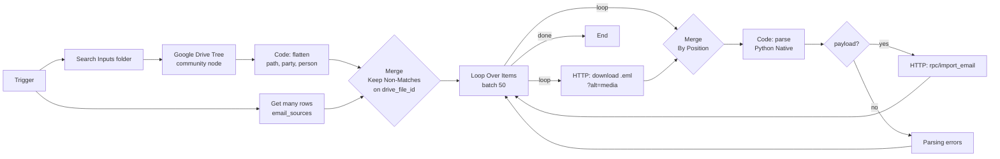

# Email archive pipeline – n8n + Supabase

A pipeline that imports customer emails (`.eml` files stored on Google Drive) into a Supabase database, cleans them, and measures cleaning quality with an AI evaluator.

It replaces an earlier notebook that produced one `.txt` file per customer.

---

## Contents

1. [Layered architecture](#1-layered-architecture)
2. [`emails_raw` layer – done](#2-emails_raw-layer--done)
   - [Tables and views](#21-tables-and-views)
   - [Duplicate detection](#22-duplicate-detection)
   - [n8n import workflow](#23-n8n-import-workflow)
   - [Parsing and cleaning rules](#24-parsing-and-cleaning-rules)
   - [How to run it](#25-how-to-run-it)
   - [Issues found and fixes](#26-issues-found-and-fixes)
3. [`emails_clean` layer – next steps](#3-emails_clean-layer--next-steps)
4. [Open points](#4-open-points)
5. [Repository files](#5-repository-files)

---

## 1. Layered architecture

| Layer | Content | Written by | Rule |
|---|---|---|---|
| `emails_raw` | result of the Drive import | import workflow only | **never edited by hand** |
| `emails_clean` | cleaned text (regex → AI → human correction), evaluator verdict, review status | cleaning/eval workflows + manual review | corrections happen here |
| *(future)* analytics layer | Q&A pairs, quotes, metadata for RAG | SQL views/functions | read-only |

Tools:

- **Google Drive** – archive of `.eml` files (an `Inputs` folder)
- **n8n**, self-hosted with a Python task runner – orchestration
- **Supabase** (Postgres) – database
- **TypeSafe AI / Jev** – pass/fail evaluator of cleaning quality
- *(planned)* **Cloudflare Workers AI** – AI text cleaning

---

## 2. `emails_raw` layer – done

### 2.1 Tables and views

```
emails_raw
├── parties          one conversation thread (customer folder or group)
├── contacts         one email address (customers and staff)
├── party_contacts   who takes part in which party (many-to-many)
├── emails           one unique email
├── email_sources    every .eml file seen on Drive, duplicates included
├── party_last_tour_block  (view) latest tour description sent per party
└── qa_pairs              (view) customer message → first staff reply
```

| Table | One row = | Key / constraints |
|---|---|---|
| `parties` | a customer folder, or a group (e.g. `<TOUR_CODE>/<GROUP>/<Person>`) | unique `folder_path` |
| `contacts` | one email address, lowercase | unique `email`, `is_staff` |
| `party_contacts` | one person in a party | PK `(party_id, contact_id)` |
| `emails` | one email | unique `dedup_key` |
| `email_sources` | one `.eml` file on Drive | PK `drive_file_id`, `is_duplicate` |

Main columns of `emails`: `party_id`, `from_contact_id`, `file_path`, `person_folder`, `message_id`, `in_reply_to`, `sent_at`, `subject`, `to_addrs`, `cc_addrs`, `speaker` (customer / staff), `body_raw`, `body_clean`, `tour_block`, `dedup_key`.

**Parties and people.** A party is the conversation thread, not a single person. Two people on the same tour writing from different addresses belong to the same party:

```
<TOUR_CODE>/<GROUP>/Person A   ┐
<TOUR_CODE>/<GROUP>/Person B   ├→ party = <GROUP>, person_folder = Person A / B / C
<TOUR_CODE>/<GROUP>/Person C   ┘
```

**Function `emails_raw.import_email(p jsonb)`.** Called once per file by the workflow. In a single transaction it:

1. creates or updates the party;
2. creates or updates the sender's contact;
3. inserts the email **only if** its `dedup_key` does not exist yet;
4. records the file in `email_sources` (`is_duplicate = true` if the email already existed);
5. links people to the party (the sender if a customer, non-staff recipients if staff wrote it).

It returns `new` or `duplicate`.

Security: RLS enabled on every table, `execute` revoked from `anon` and `authenticated`; access only with the secret key (`service_role`). The schema is exposed in the Data API for n8n only.

### 2.2 Duplicate detection

A file name does **not** identify an email: in every folder files are named `1.eml`, `2.eml`…, and numbering can change between exports.

| Identifier | Read from | Stable across exports? | Purpose |
|---|---|---|---|
| `dedup_key` = `mid:` + normalised Message-ID | email header | yes | decides whether the email is new |
| `dedup_key` = `sha:` + SHA-256 of sender, date, subject, body | when the Message-ID is missing | yes, if the text is identical | fallback |
| `drive_file_id` | Drive listing | no (changes if the file is re-uploaded; kept if moved) | avoid re-downloading known files |
| `file_path` | Drive listing | no | only used to assign party and person |

Two levels of control:

- **before download** – a Merge node drops `drive_file_id`s already present in `email_sources` (saves downloads);
- **after parsing** – `import_email()` checks the `dedup_key` (guarantees an email is never duplicated, even if its file was re-uploaded with a new ID).

### 2.3 n8n import workflow



| # | Node | Key settings |
|---|---|---|
| 1 | **Google Drive Tree** (community node `n8n-nodes-google-drive-tree`) | root = `Inputs` folder → full tree in one call |
| 2 | **Code "flatten"** (Python) | one item per `.eml` with `drive_file_id`, `file_path`, `party_path`, `party_label`, `segment`, `tour_code`, `person_folder` |
| 3 | **Get many rows** (Supabase) | schema `emails_raw`, table `email_sources`, **Return All** on, **Always Output Data** on |
| 4 | **Filter Merge** | Combine · Matching Fields `drive_file_id` · **Keep Non-Matches** · Output Data From = the Drive files input |
| 5 | **Loop Over Items** | batch of 50; every branch (import **and** errors) returns to the loop |
| 6 | **HTTP download** | `GET https://www.googleapis.com/drive/v3/files/{{ $json.drive_file_id }}?alt=media`, Google Drive credential, Response = **Text** into `eml`, batching 10 / 1000 ms, retry on fail |
| 7 | **Join Merge** | Combine · **By Position** · Input 1 = download, Input 2 = same input as the download |
| 8 | **Code "parse"** (Python Native) | see 2.4; outputs `payload` or `error` |
| 9 | **IF** | `{{ $json.payload }}` exists |
| 10 | **HTTP import** | `POST https://<PROJECT_REF>.supabase.co/rest/v1/rpc/import_email`, Supabase API credential, header `Content-Profile: emails_raw`, body `{{ JSON.stringify({ p: $json.payload }) }}`, Response = **Text** into `status` |

Constraints of the n8n Python sandbox:

- standard library only (`re`, `email`, `html`, `hashlib` allow-listed on the runner);
- **no classes** (error `__build_class__ not found`);
- access only to incoming items (`_items`), not to other nodes → data from different nodes is joined with a **Merge** before the Code node.

### 2.4 Parsing and cleaning rules

**Party and person** – the party is the folder containing the `.eml` files; groups inside a tour-code folder are the exception (see 2.1). Folder names are normalised (double and trailing spaces removed).

**Speaker** – staff if the sender belongs to the company domain (`<COMPANY_DOMAIN>`) or to an explicit `STAFF_EMAILS` list, otherwise customer. Matching on a first name in the sender field was dropped because it produced false positives on surnames.

**Body** – the `text/plain` part is preferred; if missing, HTML is converted to text with regex.

`body_raw` = full text. `body_clean` = the new message only, produced in this order:

| # | Removed | Detected by |
|---|---|---|
| 1 | HTML | no `text/plain` part |
| 2 | extra spaces and blank lines | 5+ spaces, multiple blank lines |
| 3 | staff signature and everything after it | the first line of the company signature (`<SIGNATURE_LINE>`) |
| 4 | "Sent from…" | from there to the end |
| 5 | quoted email | first line with `On … wrote:`, `On <date>`/`On <weekday>`, `Il giorno … ha scritto:`, `--- Original Message ---`, Outlook headers `From:/Sent:` or `Da:/Inviato:`, `__________` |
| 6 | quoted lines | lines starting with `>` |
| 7 | tour boilerplate (staff emails only) | a line ending in `- tour` / `- shared small group tour` → moved to `tour_block`, replaced by the placeholder `[TOUR DETAILS BLOCK — vedi emails.tour_block]` |

Other fixes:

- duplicated headers in exports (`Subject: Subject: …`, `Date: Date: …`) are normalised;
- the `\x00` character is removed (Postgres rejects it);
- if file metadata (`drive_file_id`, `party_path`) is missing, the item exits with a readable error instead of reaching the database.

### 2.5 How to run it

**First load / testing**

1. For tests, point the Drive Tree at a subfolder and add a **Limit** after the filter Merge.
2. Before the full load: root = `Inputs`, remove the Limit, and empty the tables if they hold test data:
   ```sql
   truncate emails_raw.email_sources, emails_raw.emails, emails_raw.party_contacts,
            emails_raw.parties, emails_raw.contacts restart identity cascade;
   ```

**Later runs** – just run the workflow again: only files with a never-seen `drive_file_id` are downloaded. If a run stops halfway, running it again resumes from the first file not yet imported.

**Checks**

```sql
-- emails, files and duplicates
select
  (select count(*) from emails_raw.emails)                           as unique_emails,
  (select count(*) from emails_raw.email_sources)                    as registered_files,
  (select count(*) from emails_raw.email_sources where is_duplicate) as duplicate_files,
  (select count(*) from emails_raw.parties)                          as parties;

-- emails found in more than one file/folder
select e.id, e.subject, array_agg(s.file_path) as files
from emails_raw.emails e
join emails_raw.email_sources s on s.email_id = e.id
group by e.id, e.subject
having count(*) > 1;
```

Status at the time of writing: full archive imported (several thousand files in several hundred folders), no duplicates.

### 2.6 Issues found and fixes

| Issue | Cause | Fix |
|---|---|---|
| The Google Drive node does not search subfolders | limitation of the native node | Google Drive Tree community node |
| Download returned only `{"kind":"drive#file",…}` | missing `alt=media` | parameter added to the URL |
| `Response body is not valid JSON` | both the `.eml` and the RPC response are plain text | Response Format = Text |
| `Quota exceeded … Units per minute per user` | too many Drive requests in a short time | batching + interval, retry, Loop Over Items |
| File metadata lost after download | HTTP Request replaces the item | Merge By Position between download and original input |
| `__build_class__ not found` | Python sandbox without classes | HTML parser rewritten with regex |
| `null value in column "folder_path"` | file metadata did not reach the parse node | corrected Merge + explicit check in the parse node |
| Already-imported files not filtered out | Get many rows without Return All / 1,000-row API limit | Return All on, Max rows raised in Data API settings |
| Loop never reaching *done* | error branch not connected to the loop; filter Merge also passing DB rows | error branch → loop; Output Data From = Drive input |
| `$$` error in the SQL Editor | delimiter not recognised | named delimiters (`$fn$ … $fn$`) |

---

## 3. `emails_clean` layer – next steps

### 3.1 Create the layer

Scripts: `sql/emails_clean_layer.sql`, then `sql/emails_raw_cleanup.sql`.

- table `emails_clean.emails`, one row per email: `body_raw` (copy), `body_clean` (editable), `tour_block`, `source` (`regex` / `ai` / `human`), `verdict`, `confidence`, `eval_model`, `prompt_version`, `reviewed`, `updated_at`;
- **trigger** on `emails_raw.emails`: every newly imported email lands in `emails_clean` automatically;
- website **form notifications** (only `Tour: / Email: / Service:` lines) are excluded from the layer;
- views for the workflows: `to_eval`, `to_ai`, `jev_examples`;
- the cleanup script restores `emails_raw` to import tables only.

After the scripts: add `emails_clean` to the *Exposed schemas* (Project Settings → Data API).

### 3.2 AI cleaning

Regex has reached its limit; a language model finishes the job.

- **Model**: Cloudflare Workers AI (e.g. `@cf/google/gemma-4-26b-a4b-it`), called with an HTTP Request (`/ai/run/<model>`, `max_tokens: 2048`, `temperature: 0`).
- **Rule**: the model may **only remove** text, never rewrite, summarise or translate.
- **Guardrail**: a Python node rejects responses containing lines that do not exist in the input text.
- **Workflow**: `to_ai` (50 random rows) → Workers AI → Merge By Position → check → **Update row** on `emails_clean.emails` (`body_clean`, `source = 'ai'`, `ai_model`, `verdict = null` so it gets re-evaluated).
- Before the full run: test on 20 emails and compare by hand.

### 3.3 Evaluation with Jev

A workflow separate from the import:

```
Trigger → jev_examples → Code "Jev examples" → to_eval (Limit 50) → TypeSafe AI (Jev) → Update row
```

- Jev answers `Pass` / `Fail` with a confidence score (`route.choice`, `route.confidence`).
- **Examples** are the rows with `reviewed = true`, injected into Jev's instructions on every run.
- `prompt_version` tracks instruction versions (`v1` without examples, `v2` with examples).
- Operating threshold: `confidence < 0.7` = check by hand.

### 3.4 Manual review

In the Supabase Table Editor → schema `emails_clean` → table `emails`, filter `reviewed = false`, sort by `confidence`:

| Case | Action |
|---|---|
| Jev is right | `reviewed = true` |
| Jev is wrong | flip `verdict`, `reviewed = true` |
| Text is wrong | fix `body_clean`, `source = 'human'`, `verdict = 'pass'`, `reviewed = true` |

Rule: `verdict` always describes the text as it is **now**. Spot-check a sample of high-confidence `pass` rows from time to time.

### 3.5 Cleaning rules in SQL

Fixed, recurring rules can live in the database:

- function `emails_clean.clean_text(text)` holding the rules (`regexp_replace`);
- procedure `emails_clean.run_rules()` applying them to rows with `source = 'regex'`;
- automatic execution with **pg_cron** (e.g. hourly).

n8n remains the orchestrator for everything that talks to external services (Drive, AI, Jev).

### 3.6 Metrics

```sql
-- cleaning and evaluation status
select source, verdict, reviewed, count(*)
from emails_clean.emails
group by 1, 2, 3
order by 1, 2, 3;

-- comparison between Jev instruction versions
select prompt_version,
       count(*)                                     as verdicts,
       round(avg((verdict = 'fail')::int) * 100, 1) as pct_fail,
       round(avg(confidence), 2)                    as avg_confidence
from emails_clean.emails
where verdict is not null
group by 1;
```

To watch: fail rate before and after AI cleaning; how often human review overturns Jev (evaluator precision). Examples given to Jev must not be used to measure it.

### 3.7 Optional: review interface

**NocoDB** self-hosted, connected to Postgres with a dedicated user (read access to everything, write access only to review fields), for a more comfortable review than the Table Editor.

---

## 4. Open points

- **Files moved between folders** – they keep their `drive_file_id` and are not reprocessed: the party in the DB is not updated.
- **Unrecognised boilerplate** – quotes with headers other than `- tour` stay in `body_clean` (to be handled by AI cleaning or new rules).
- **`On Mon…` rule** – can cut customer sentences starting with "On Monday…".
- **Staff addresses** – add any staff addresses outside the company domain to `STAFF_EMAILS`.
- **Party members** – suppliers or hotels copied on staff emails end up in `party_contacts`.
- **Analytics layer** – move `qa_pairs` and `party_last_tour_block` onto `emails_clean` (cleaned text) and prepare data for RAG.

---

## 5. Repository files

| File | Content |
|---|---|
| `sql/schema.sql` | initial tables and views |
| `sql/migration_dedup.sql` | `dedup_key`, `email_sources`, import function |
| `sql/import_email.sql` | `import_email` function in the `emails_raw` schema + permissions |
| `sql/emails_clean_layer.sql` | `emails_clean` layer, triggers, views |
| `sql/emails_raw_cleanup.sql` | restores `emails_raw` to import tables only |
| `n8n/parse_node.py` | parse node code |
| `n8n/import_workflow.json` | export of the import workflow |

> Before publishing: remove project IDs, Drive folder IDs, credentials, company names, staff names and any customer data from every file.
